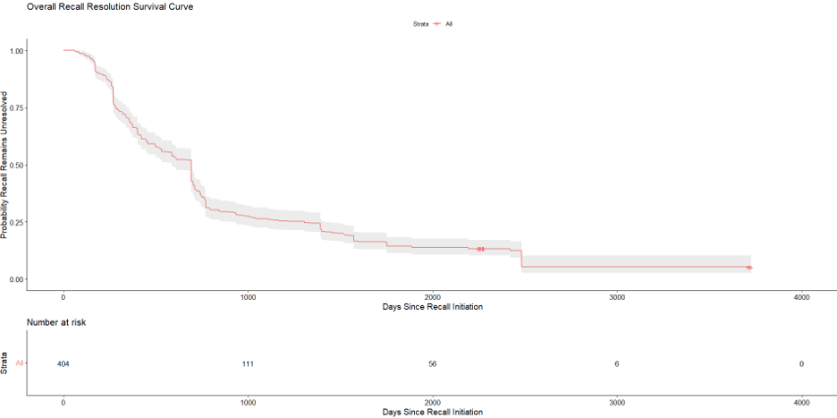
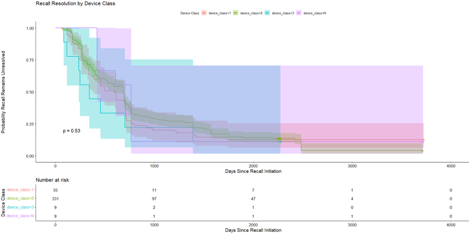
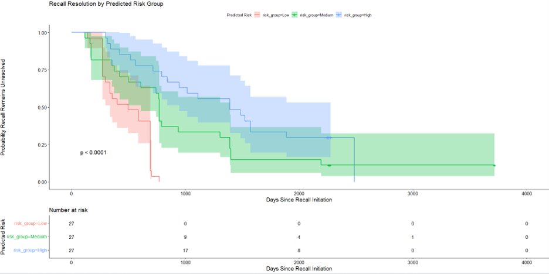

# Medical Device Recall Risk Analytics Using R

## Project Overview
This project applies survival analysis and business analytics techniques to investigate factors associated with medical device recall resolution times. The objective is to identify characteristics associated with prolong recalls, evaluate statistical models for time to event analysis, and support data driven risk monitoring and resource prioritization.

The analysis includes 404 medical device recall observations and integrates Kaplan - Meier estimation, Cox proportional hazards regression, parametric accelerated failure time (AFT) models, and natural cubic splines.

An interactive Power BI dashboard was also developed to communicate descriptive statistics, recall resolution patterns, and analytical findinds. 

## Business Questions
Which medical device classifications are associated with longer recall resolution times?
Which medical specialties and recall root causes are associated with resolution duration?
How does the probability of a recall remaining unresolved change over time?
Can nonlinear relationships improve statistical model fit?
How can survival analysis results support recall monitoring and resource prioritization?

## Data Source
Dataset: https://www.kaggle.com/datasets/kylefengkfeng209/medical-device-recall-survival-data

The analytical dataset contains 404 complete observations and 8 variables.

Variables:
- followup_days
- event_observed
- device_class
- medical_specialty
- root_cause_description
- products_in_event
- n_k_numbers
- reason_length_chars

Of the 404 observations, 359 (88.9%) experienced recall resolution, while 45 (11.1%) were censored.

## Tools
## Programming and Statistical Analysis
- R
- Survival Analysis
- Kaplan - Meier Estimation
- Cox Proportional Hazards Regression
- Parametric accelerated failure time models
- Natural cubic splines
- Model selection and diagnostic testing

## Business Intelligence and Reporting
- Microsoft Power BI
- DAX
- LaTeX / Overleaf
- GitHub
## Research Report
[Read Full Statistical Analysis Report](reports/Medical_Device_Recall_Risk_Analytics_Using_R___Antonio_Garcia.pdf)

## Methodology
## 1. Data Preprocessing and Exploratory Analysis
   The dataset was cleaned and prepared by selecting relevant variables, assigning appropriate data types, removing incomplete observations, and combining sparsely represented categorical levels.
   Descriptive statistics and graphical analyses were performed to examine the distributions of device classifications, medical specialties, recall root causes, and numerical predictors.
## 2. Kaplan - Meier Survival Analysis
   Kaplan - Meier survival estimates were used to examine the probability of recalls remaining unresolved over time.
   Survival distributions were compared across device classifications using the log rank test.
## 3. Cox Proportional Hazards Regression
   A multivariate Cox proportional hazards model was fitted to investigate the relationships between recall characteristics and resolution hazards.
   The model achieved a training set concordance index of  0.657.
   However, Schoenfeld residual diagnostics indicated a significant violation of the proportional hazards assumption (global p - value < 0.001), motivating the investigation of alternative survival models.
## 4. Parametric Accelerated Failure Time Models
   Four candidate AFT distributions were evaluated:
   - Exponential
   - Weibull
   - Lognormal
   - Log - logistic
   Models were compared using the Akaike Information Criterion (AIC) and the log - logistic distribution achieved the lowest AIC among the four candidate distributions.
## 5. Spline Enhanced Log -Logistic AFT Model
   Natural cubic splines with three degrees of freedom were incorporated for the numerical predictors.
   - Number of products involved in each recall
   - Number of associated 510(k) numbers
   - Recall reason description length
   This approach allowed the model to accommodate potentially nonlinear relationships between predictors and log recall resolution time.
   Further, the spline enhanced model reduced AIC by 52.454.
   A likelihood ratio test demonstrated a statistically significant improvement in model fit (χ² = 64.454, df = 6, p-value < 0.001)
## 6. Model Diagnostics
   Model diagnostics included:
   - Schoenfeld residual tests for proportional hazards
   - Response residual analysis
   - Cox - Snell residual goodness of fit assessment
   - Generalized variance inflation factors for multicollinearity
   - AIC and likelihood ratio model comparisons
  
  Cox - Snell residual analysis identified deviations from the theoretical reference distributions, particularly at larger residual values, suggesting potential limitations in the fitted model's tail behavior.
  ## 7. Business Intelligence Dashboard
  A Power BI dashboard was developed to communicate the statistical findings through interactive visualizations.
  Dashboard components include:
  - Executive overview and recall KPIs
  - Device classification and root cause distributions
  - Medical specialty comparisons
  - Predicted resolution durations and exploratory risk assessment

## Key Findings

1. Model assumptions matter. The Cox proportional hazards model demonstrated significant proportional hazards violations, making the interpretation of constant hazard ratios inappropriate for several predictors.
2. The log - logistic distribution provided the best relative fit among the four initial parametric AFT distributions.
3. Incorporating natural cubic splines substantially improved model fit. The spline enhanced log - logistic AFT model achieved an AIC reduction of 52.454 relative to the original linear effects model.
4. Device characteristics were associated with resolution duration. Class II device had longer predicted resolution times than Class I devices (TR = 2.385), while several medical specialties and root causes also exhibited    significant associations.
5. Further validation remains necessary. Although the spline enhanced model demonstrated improved fit on the training data, its out of sample predictive performance has not yet been established.

## Visual Results
## Overall Recall Resolution
The Kaplan - Meier survival curve illustrates how the estimated probability of a recall remaining unresolved changes over time.

## Recall Resolution by Device Class
The Kaplan - Meier survival curves were compared across device classifications. The log - rank test did not identify statistically significant differences among the groups.

## Recall Resolution by Predicted Risk Group
The original predictive risk analysis investigated differences in recall resolution patterns among risk categories.

## Limitations
The analysis is subject to several limitations, including imbalanced categorical group sizes, censoring, potential model misspecification, and the relatively small dataset.
The spline enhanced model improved in sample fit, but the diagnostic deviations suggest that the assumed survival time distribution may not fully characterize all observations.

## Future Work
Future work will focus on:
- Evaluating predictive performance using the independent testing dataset
- Comparing survival model discrimination and calibration
- Expanding the Power BI visualizations

## Conclusion
This project demonstrates how survival analysis, statistical modeling, and business intelligence can be integrated to investigate medical device recall resolution times.

The spline - enhanced log logistic AFT model demonstrated substantially better in sample fit than the original linear effects model, while model diagnostics highlighted the importance of assessing the underlying model assumptions.

Overall,  this project illustrates the potential application of advanced statistical techniques to recall monitoring, exploratory risk assessment, and data driven decision making. 

# Power BI Interactive Dashboard Preview

## Author
Antonio Garcia
M.S. Applied Statistics
